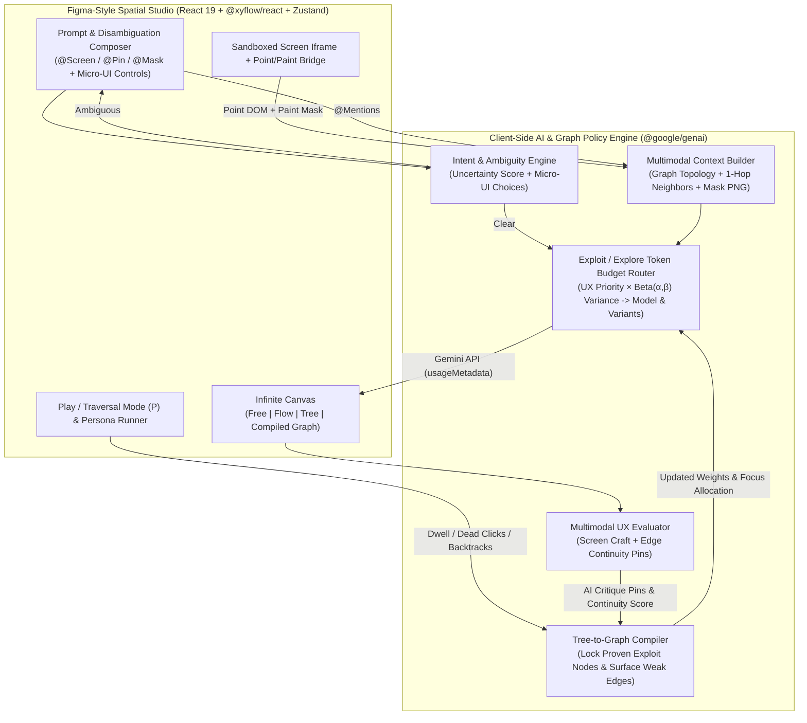

# Forkcast Studio — Architecture & Implementation Plan

This document defines the client-side architecture, data schemas, multimodal Point & Paint bridge, empirical traversal test runner, Tree-to-Graph compiler, and Exploit/Explore token budget engine for **Forkcast Studio**.

## Locked MVP Decisions

| Decision | Choice |
|---|---|
| **Default Artboard & Initial State** | **Desktop web frames (`1280×800`)** by default (scaled cleanly on the infinite canvas like Figma desktop frames) with a one-click **Mobile (`390×844`)** toggle; opens pre-loaded with a rich starter journey so every canvas interaction works immediately. |
| **Multimodal Disambiguation & Input** | **Interactive visual micro-UI controls** (choice cards, palette/layout swatches, sliders, scope chips) **+ optional Mic / Voice input** (*Paint & Speak* via browser Web Speech API directly in the Paint popover and Prompt Composer). |
| **Act 3 Traversal & Evolution** | **Both** interactive manual **Play Mode (`P`)** walkthroughs **and** a 1-click **"Simulate Personas"** runner to rapidly generate behavioral traces, update `Beta(α, β)` posteriors, and demonstrate live Tree → Graph evolution. |
| **GenAI Runtime & Demo Resilience** | **Live client-side Gemini API (`@google/genai`)** with configurable model IDs per tier (`Flash-Lite` / `Flash` / `Pro`) in Settings **+ a built-in Demo/Mock fallback toggle** so the full 3-act workflow remains runnable offline or under rate limits. |
| **Per-Screen Options, Revisions & Final Flow Clarity** | Clicking any screen displays its **Proposed Alternatives** + a clearly badged **Finalized Version**, per-option **Show/Hide** buttons to minimize designer cognitive load, **Annotation Revisions** across all screens with per-annotation **`Include in AI`** toggles, and automatic **Final Flow highlighting** (accented node borders & edges along the committed path). |

---

## 1. Architecture Overview & Feedback Pipeline

Forkcast Studio runs **100% client-side** in Vite + React 19 + TypeScript using the browser `@google/genai` SDK (user-supplied Gemini API key stored locally).

Five tightly coupled subsystems form the closed interaction & learning loop:

1. **Intent & Ambiguity Engine (`src/ai/ambiguityEngine.ts`)**: Scores goal uncertainty (`0..1`) via structured JSON output. If intent is underspecified, emits minimum-effort **disambiguation micro-UIs** (choice cards, visual tone previews, sliders, scope chips) instead of prose walls; otherwise executes the **Direct Fast Path** starting with a low-token **Journey Skeleton** (progressive reveal).
2. **Spatial Canvas & Multimodal Screen Sandbox (`src/canvas/`)**: A Figma-style `@xyflow/react` infinite canvas supporting `Free`, `Flow (L→R)`, `Tree (T→B)`, and `Compiled Graph` layouts, rendering progressive screen frames (`skeleton` → `wireframe` → `interactive` Tailwind HTML inside sandboxed `<iframe>`s).
3. **Point & Paint Manipulation Bridge (`src/canvas/ScreenIframe.tsx`, `src/canvas/PaintOverlay.tsx`)**: Captures **Point** pins (exact hovered DOM element selector + bounding box via `postMessage`) and **Paint** masks (layered `<canvas>` brush strokes composited onto a PNG snapshot + intersecting DOM elements) so designers steer AI visually and reference `@Screen`, `@Pin`, and `@Mask` in short prompts.
4. **Traversal "Unit Test" Runner & UX Evaluator (`src/eval/traversalRunner.ts`, `src/ai/evaluator.ts`)**: Interactive **Play Mode (`P`)** and simulated persona walkthroughs record explicit pin feedback alongside implicit behavioral signals (`dwellMs`, hesitation, dead clicks, backtracking, completion). Gemini's multimodal UX Evaluator scores screen craft and cross-screen edge continuity, dropping AI critique pins directly on offending elements.
5. **Tree-to-Graph Compiler & Exploit/Explore Token Budget Policy (`src/graph/compiler.ts`, `src/ai/budgetPolicy.ts`)**: Updates per-variant **Thompson Sampling** reward distributions `Beta(α, β)` from traversal + evaluation evidence, compiles branching option trees into a persistent workflow graph (`exploit-locked` vs. `explore`), and routes the session's Gemini token budget (`Pro` + thinking vs. `Flash` vs. `Flash-Lite`) toward **Core UX Focus** and high-uncertainty branches.



---

## 2. Figma-Inspired Studio Workspace Layout

```
┌──────────────────────────────────────────────────────────────────────────────┐
│ Top Toolbar: [Project] [View: Free | Flow | Tree | Compiled Graph]           │
│              [Tool: Select (V) | Pan (H) | Point (C) | Paint (B) |           │
│                     Connect (L) | Play/Test (P)]                             │
│              [Budget: 48k / 250k tok • 66% Core Explore] [Eval] [API Key]    │
├──────────────────┬───────────────────────────────────────┬───────────────────┤
│ Left Sidebar     │                                       │ Right Inspector   │
│                  │        Infinite Spatial Canvas        │                   │
│ - Flow Tree /    │          (@xyflow/react)              │ Selected Screen / │
│   Compiled Graph │                                       │ Edge / Pin / Mask:│
│ - Focus Zones    │   ┌───────────┐       ┌───────────┐   │ - Priority Tier   │
│   (Core / Std /  │   │  Screen A │──────▶│  Screen B │   │   & Exploit/      │
│    Supporting)   │   │ [Opt 1|2] │ 92%   │ [Opt 1|2|3│   │   Explore Mode    │
│ - Exploit/Explore│   │ 🔒Exploit │       │ ★ Core    │   │ - Variant Compare │
│   Status List    │   └───────────┘       │ 🖌 Mask #1│   │ - Beta(α,β) +     │
│ - Budget Sliders │                       └───────────┘   │   Traversal Stats │
│                  │                                       │ - UX Eval Rubric  │
│                  ├───────────────────────────────────────┤ - Point & Paint   │
│                  │ Floating Prompt & Disambiguation Bar  │   Queue [Resolve] │
│                  │ [2-3 Micro-UI Choice Cards / Sliders] │                   │
│                  │ "Apply @Mask-1 on @Checkout..." [Go]  │                   │
└──────────────────┴───────────────────────────────────────┴───────────────────┘
```

### Navigation, Screen Controls & Final Flow Clarity
- **Figma controls**: Trackpad pinch/scroll zoom, `Space + Drag` or middle-mouse pan, `Shift+1` Fit to Screen, `Shift+2` Zoom to Selection, toggleable Minimap.
- **High-contrast Studio surface**: Dark neutral canvas (`#141416` with subtle dot grid) so generated UI artboards pop clearly.
- **Clicking any screen / micro-UI**:
  - Immediately **highlights the borders of all nodes and connecting edges in the Final Flow** (crisp emerald/accent outline + elevated animated edges) while softly dimming non-finalized exploratory branches so the committed user journey stays unmistakable.
  - Opens the **Alternatives & Finalized Strip** (both in the screen header/drawer and Right Inspector): pins the **Finalized Version** clearly at the top, lists all **Proposed Alternatives** with a 1-click *"Mark Finalized"* action, and provides an **Eye (`Show / Hide`) button** on each option so designers can hide distracting alternatives and minimize cognitive load (hidden options collapse into a compact *"N hidden"* pill).
  - Shows **Annotation Revisions** across all options/screens with an **`Include in AI`** toggle on every annotation so personal notes or parked feedback remain saved without being sent to Gemini.
- **Visual budget & confidence cues**:
  - **Core Focus Zones** render as soft glowing group frames with live token share badges.
  - **Compiled Graph View** styles edges by traversal traffic and completion/backtrack ratio, and badges `Exploit-Locked` screens vs. `Explore` high-uncertainty branches.

---

## 3. Consolidated Data Model (`src/types/studio.ts`)

```ts
export type PriorityTier = 'core' | 'standard' | 'supporting';
export type PolicyMode = 'explore' | 'exploit-locked';
export type FidelityStage = 'skeleton' | 'wireframe' | 'interactive';
export type CanvasViewMode = 'free' | 'flow' | 'tree' | 'compiled';
export type StudioTool = 'select' | 'pan' | 'point' | 'paint' | 'connect' | 'play';

export interface FlowProject {
  id: string;
  name: string;
  productBrief: string;
  devicePreset: 'mobile' | 'desktop';
  canvasView: CanvasViewMode;
  budgetConfig: BudgetConfig;
  screens: Record<string, ScreenNode>;
  edges: Record<string, FlowEdge>;
  focusZones: Record<string, FocusZone>;
  traces: TraversalTrace[];
  tokenLedger: TokenUsageEntry[];
  pendingDisambiguation: DisambiguationRequest | null;
}

export interface DisambiguationRequest {
  id: string;
  originalPrompt: string;
  uncertaintyScore: number;       // 0..1; >= 0.45 triggers micro-UI instead of blind generation
  rationale: string;              // 1-line reason why clarifying saves tokens
  controls: DisambiguationControl[];
  createdAt: number;
}

export type DisambiguationControl =
  | {
      id: string;
      kind: 'choice-cards';
      label: string;
      multiSelect: boolean;
      options: Array<{ id: string; title: string; subtitle: string; badge?: string }>;
      selectedIds: string[];
    }
  | {
      id: string;
      kind: 'visual-preview';
      label: string;
      options: Array<{ id: string; title: string; palette: string[]; layoutHint: string }>;
      selectedId: string | null;
    }
  | {
      id: string;
      kind: 'slider';
      label: string;
      min: number;
      max: number;
      step: number;
      unit: string;
      value: number;
      minLabel: string;
      maxLabel: string;
    }
  | {
      id: string;
      kind: 'chips';
      label: string;
      options: string[];
      selected: string[];
    };

export interface ScreenNode {
  id: string;
  slug: string;                   // Used for @references, e.g. "Checkout" -> @Checkout
  title: string;
  stage: string;                  // e.g. "Onboarding", "Conversion", "Settings"
  description: string;
  priority: PriorityTier;
  policyMode: PolicyMode;         // 'exploit-locked' skips redundant re-generation
  fidelity: FidelityStage;        // Progressive reveal stage
  isInFinalFlow: boolean;         // Highlighted with final-flow borders/edges on screen click
  position: { x: number; y: number };
  variants: DesignVariant[];
  activeVariantId: string | null; // Currently previewed alternative on the artboard
  finalizedVariantId: string | null; // Explicitly committed "Finalized" design for this screen
  annotations: ScreenAnnotation[];
  evaluation: EvaluationReport | null;
  status: 'idle' | 'generating' | 'evaluating' | 'error';
}

export interface BanditStats {
  alpha: number;                  // Positive evidence prior + completions / approvals
  beta: number;                   // Negative evidence prior + hesitations / backtracks / critical pins
  impressions: number;            // Traversal visits
  completions: number;
  hesitations: number;            // Visits exceeding screen dwell threshold or dead-click bursts
  backtracks: number;             // Immediate returns to previous screen
  avgDwellMs: number;
}

export interface DesignVariant {
  id: string;
  label: string;                  // e.g. "Option A — Minimal Card"
  rationale: string;
  fidelity: FidelityStage;
  isHidden: boolean;              // Designer cognitive-load toggle: hide/show option on canvas & strips
  html: string;                   // Self-contained Tailwind HTML rendered inside iframe
  skeletonBullets?: string[];     // Ultra-cheap progressive preview before HTML expansion
  createdAt: number;
  parentVariantId?: string;       // Tree lineage across iterations
  modelUsed: string;
  tokensUsed: number;
  banditStats: BanditStats;
}

export interface FlowEdge {
  id: string;
  sourceScreenId: string;
  targetScreenId: string;
  label: string;                  // e.g. "Tap Subscribe", "Back", "Payment Failed"
  edgeType: 'primary' | 'alternate' | 'error' | 'back';
  isFinalFlowEdge: boolean;       // Highlighted clearly whenever any screen is clicked
  condition?: string;
  metrics: {
    traversals: number;
    completions: number;
    backtracks: number;
    continuityScore?: number;     // 0..100 from cross-screen UX evaluation
  };
}

export interface AnnotationRevision {
  id: string;
  revisionNumber: number;         // Monotonic v1, v2, v3...
  timestamp: number;
  author: 'designer' | 'ai-evaluator';
  comment: string;
  category: ScreenAnnotation['category'];
  status: 'open' | 'resolved';
  resolvedByVariantId?: string;   // Links resolution back to the generated variant
}

export interface ScreenAnnotation {
  id: string;
  mentionTag: string;             // e.g. "Pin-1" or "Mask-1" for @Pin-1 / @Mask-1 prompts
  screenId: string;
  variantId: string;
  author: 'designer' | 'ai-evaluator';
  kind: 'point-element' | 'paint-region';
  includeInAiFeedback: boolean;   // Opt-in/out switch for sending this annotation to the AI agent
  xPercent: number;               // Anchor coordinate (0..100)
  yPercent: number;
  elementTarget?: {
    selector: string;             // CSS path / data-fc-id inside iframe
    tagName: string;
    textSnippet: string;
    boundingBox: { x: number; y: number; w: number; h: number };
  };
  paintTarget?: {
    strokes: Array<Array<{ xPercent: number; yPercent: number }>>;
    boundingBoxPercent: { x: number; y: number; w: number; h: number };
    maskDataUrl?: string;         // Composite PNG sent to Gemini multimodal input
    intersectingSelectors: string[];
  };
  category: 'usability' | 'hierarchy' | 'copy' | 'accessibility' | 'layout' | 'flow';
  severity?: 'info' | 'warning' | 'critical';
  comment: string;                // Latest revision text
  status: 'open' | 'resolved';
  revisions: AnnotationRevision[]; // Full saved revision history for this annotation
  createdAt: number;
}

export interface TraversalStep {
  screenId: string;
  variantId: string;
  edgeIdTaken?: string;
  enteredAt: number;
  dwellMs: number;
  deadClicks: number;             // Clicks on non-interactive elements
  hesitated: boolean;
  backtracked: boolean;
}

export interface TraversalTrace {
  id: string;
  actor: 'designer' | 'simulated-persona';
  personaLabel?: string;
  startedAt: number;
  completed: boolean;
  steps: TraversalStep[];
}

export interface EvaluationReport {
  overallScore: number;           // 0..100
  dimensions: {
    usability: number;
    visualHierarchy: number;
    accessibility: number;
    flowContinuity: number;
  };
  summary: string;
  modelUsed: string;
  tokensUsed: number;
  evaluatedAt: number;
}

export interface FocusZone {
  id: string;
  name: string;
  priority: PriorityTier;
  screenIds: string[];
  budgetWeight: number;
}

export interface TierPolicy {
  model: string;                  // Pro + thinking for core, Flash for standard, Flash-Lite for supporting
  thinkingBudget: number;
  defaultVariantCount: number;    // 3-4 for core, 2 for standard, 1 for supporting
  initialFidelity: FidelityStage; // 'interactive' for core, 'wireframe' for standard, 'skeleton' for supporting
  evaluationDepth: 'deep' | 'standard' | 'quick';
}

export interface BudgetConfig {
  totalTokenBudget: number;       // e.g. 250_000
  tierShares: Record<PriorityTier, number>; // e.g. { core: 0.62, standard: 0.25, supporting: 0.13 }
  tierPolicies: Record<PriorityTier, TierPolicy>;
}

export interface TokenUsageEntry {
  id: string;
  timestamp: number;
  action: 'disambiguate' | 'generate-flow' | 'generate-variant' | 'point-paint-refine' | 'ux-eval';
  screenId?: string;
  priority: PriorityTier;
  model: string;
  promptTokens: number;
  outputTokens: number;
  thoughtTokens: number;
  totalTokens: number;
}
```

---

## 4. Deep Dive on the 5 Core Subsystems

### 4.1 Intent & Ambiguity Engine + Progressive Reveal (`src/ai/ambiguityEngine.ts`)
- **Fast Pre-Flight Check**: Every new top-level prompt runs through a lightweight structured-output Gemini call (`Flash-Lite` / low-token schema) that returns `{ uncertaintyScore, missingDecisions[], disambiguationControls[] }`.
- **Zero Wall-of-Text Disambiguation**: When `uncertaintyScore >= 0.45`, the Floating Composer expands into interactive micro-UI cards (e.g., *"2-step vs. 1-page checkout"*, *"Visual tone: Editorial vs. High-Contrast Utility"*, *"Information Density slider"*). One click submits structured selections directly into the **Direct Fast Path**.
- **Progressive Reveal**: Flow generation first creates cheap `skeleton` nodes (title, stage, 3 bullet affordances, transition edges) across the whole journey (~1–2k tokens total). Only screens inside **Core Focus Zones** (or screens explicitly clicked/promoted by the designer) automatically expand into full multi-option `interactive` HTML/Tailwind renders.

### 4.2 Sandboxed Screen Renderer + Point & Paint Bridge (`src/canvas/ScreenIframe.tsx`, `src/canvas/PaintOverlay.tsx`)
- **Isolated `<iframe>` (`sandbox="allow-scripts"`)**: Renders generated HTML + Tailwind CSS via `srcdoc`, completely isolated from Studio CSS, with a ~50-line **Forkcast DOM Bridge** script.
- **Point Mode (`C`)**: Hovering inside the iframe highlights the exact DOM element (`box-sizing` overlay + `<button> "Continue"` tag). Clicking posts `{ selector, tagName, textSnippet, boundingBox, xPercent, yPercent }` to the React host and opens an inline Figma-style comment popover tagged `@Pin-N`.
- **Paint Mode (`B`) & Voice ("Paint & Speak")**: Activates a transparent `<canvas>` overlay directly above the screen frame. The designer brushes over any region (e.g., an awkward card group or header), either types or clicks the **Mic button (Web Speech API)** to speak a 4-word tweak (*"turn this into tabs"*), and Forkcast:
  1. Computes the stroke bounding box and queries the iframe bridge for all intersecting DOM selectors and computed layout context;
  2. Exports a lightweight composite mask snapshot (`maskDataUrl`) showing the painted region on the rendered screen;
  3. Attaches it as `@Mask-N` (`kind: 'paint-region'`) for multimodal Gemini refinement.

### 4.3 `@Screen`, `@Pin` & `@Mask` Graph-Aware Context Builder (`src/ai/contextBuilder.ts`)
- **Live `@` Autocomplete**: Typing `@` in the Floating Prompt Composer suggests every screen slug (`@Checkout`), open pin (`@Pin-1`), or painted mask (`@Mask-2`), plus `@SelectedZone`.
- **Token-Efficient Context Assembly**: Instead of dumping every screen in the project into every call, `contextBuilder.ts` sends:
  1. A compact graph topology adjacency list (`id -> slug [priority, finalFlow] --(edgeLabel)--> target`);
  2. Full HTML + active/finalized variant + **only annotations where `includeInAiFeedback === true`** (including latest revision context) for explicitly `@referenced` or targeted screens;
  3. Compact structural summaries of **1-hop upstream/downstream neighbors** (so visual tokens, cart items, or navigation chrome stay consistent);
  4. Multimodal image parts for any included `@Mask` snapshots (`inlineData`).
- Structured output (`responseSchema`) allows Gemini to return both variant HTML updates and graph mutations (`addScreens`, `addEdges`, `removeEdges`, `resolvedAnnotationIds`).

### 4.4 Traversal as Live "Unit Test" + Multimodal UX Evaluator (`src/eval/traversalRunner.ts`, `src/ai/evaluator.ts`)
- **Play / Traversal Mode (`P`)**: Turns the canvas into a clickable interactive flow runner. Clicking a screen CTA labeled with a matching transition (`data-fc-edge` or inferred button text) navigates along that `FlowEdge` to the target screen.
- **Implicit Behavioral Signals**:
  - **Dwell & Hesitation**: Tracks `dwellMs` per step; exceeding a configurable threshold (e.g., `> 12s` on a single card) or triggering `>= 2` **dead clicks** on non-interactive elements flags `hesitated: true`.
  - **Backtracking**: Immediately returning to the prior screen along a `back` edge increments `backtracks` on both the variant and the edge.
  - **Simulated Personas**: Optionally dispatches LLM-driven user personas (e.g., *"impatient mobile buyer"*, *"first-time subscriber"*) across the graph to generate synthetic `TraversalTrace`s before human testing.
- **Automated Multimodal UX Evaluator**: Evaluates both single-screen craft (`usability`, `visualHierarchy`, `accessibility`) and cross-screen `flowContinuity` along incoming/outgoing edges, emitting structured `AI-Evaluator` pins directly onto weak DOM elements.

### 4.5 Tree-to-Graph Compiler & Exploit/Explore Token Budget Policy (`src/graph/compiler.ts`, `src/ai/budgetPolicy.ts`)
- **Empirical Reward Updates (Thompson Sampling)**: Each `DesignVariant` carries `banditStats: { alpha, beta, ... }`:
  - Completion + high UX eval (`>= 80`) + designer approval increment `alpha`;
  - Hesitation, dead clicks, backtracking, or `critical` UX pins increment `beta`.
- **Tree-to-Graph Compilation**:
  - Across iterations and traversal runs, parent→child variant explorations form a **Tree** of design experiments per screen.
  - In **Compiled Graph View**, `compiler.ts` selects the highest-posterior-mean variant (`α / (α + β)`) per state, marks high-confidence low-variance winners (`impressions >= N && lowerConfidenceBound >= threshold`) as **`exploit-locked`**, and highlights edges with high backtrack or low continuity scores as **UX bottlenecks**.
- **Exploit + Explore Budget Router (`BudgetedGenAIClient`)**:
  - Every Gemini call passes through `budgetPolicy.ts`, computing an allocation score from **Designer UX Priority (`core` > `standard` > `supporting`) × Exploration Need (`Beta` variance / bottleneck status)**.
  - **`exploit-locked` or `supporting` screens** use `Flash-Lite` with `thinkingBudget: 0`, `1` variant, and skip redundant re-generation unless explicitly unlocked.
  - **`core` + `explore` screens** receive `~60–65%` of the session token budget: higher-reasoning Gemini (`Pro` + thinking budget), `3–4` divergent options via Thompson sampling, multimodal Point & Paint refinement, and deep cross-screen UX evaluation.
  - All responses record exact `usageMetadata` (`promptTokenCount`, `candidatesTokenCount`, `thoughtsTokenCount`) into `tokenLedger`, updating live budget gauges and nudging the designer if spend drifts away from Core UX flows.

---

## 5. Proposed Project Directory Structure

```
forkcast-designer-studio/
  index.html
  package.json
  vite.config.ts
  src/
    main.tsx
    App.tsx
    types/
      studio.ts                 # Consolidated graph, disambiguation, point/paint, bandit, budget types
    store/
      useStudioStore.ts         # Zustand store + persistence + undo/redo + token ledger
      presets.ts                # Starter coffee subscription flow with sample variants & traces
    ai/
      geminiClient.ts           # Client-side @google/genai wrapper + usageMetadata accounting
      ambiguityEngine.ts        # Uncertainty scoring + multimodal disambiguation micro-UIs
      budgetPolicy.ts           # UX Priority + Exploit/Explore -> model, thinking, variant count
      contextBuilder.ts         # @Screen / @Pin / @Mask + 1-hop neighbor multimodal payload builder
      evaluator.ts              # Multimodal screen craft + edge continuity evaluator
      prompts.ts                # Structured JSON schemas for skeleton, HTML variants, and Point/Paint edits
    graph/
      compiler.ts               # Tree-to-Graph compilation, Beta(α,β) updates & Thompson sampling
      autoLayout.ts             # Dagre layouts for Flow (L->R), Tree (T->B), and Compiled Graph views
    eval/
      traversalRunner.ts        # Play Mode click/dwell/dead-click/backtrack tracker + persona simulator
    canvas/
      StudioCanvas.tsx          # @xyflow/react canvas, Figma navigation, mode & view switchers
      ScreenNodeCard.tsx        # Progressive frame (Skeleton / Wireframe / Live HTML) + variant tabs
      ScreenIframe.tsx          # Sandboxed HTML/Tailwind renderer + postMessage DOM element picker
      PaintOverlay.tsx          # Layered <canvas> brush mask + intersecting DOM extraction + PNG export
      AnnotationLayer.tsx       # Point pins + Paint regions + inline Figma-style comment popovers
      FlowEdge.tsx              # Interactive weighted edge with traversal/backtrack metrics & edit popup
      FocusZoneNode.tsx         # Draggable Focus Zone group frame with live token spend indicator
    components/
      TopToolbar.tsx            # Views, tools (V/H/C/B/L/P), live budget meter, Eval & API key buttons
      LeftSidebar.tsx           # Flow tree, Compiled Graph states, Focus Zones, budget sliders
      RightInspector.tsx        # Variant compare, Beta(α,β) & eval breakdown, Point/Paint resolve queue
      PromptComposer.tsx        # Floating bar with @ autocomplete, Mic/Voice input & Disambiguation Micro-UIs
      SettingsModal.tsx         # Gemini API key entry, configurable model IDs per tier, Demo/Mock toggle, token cap
```

---

## 6. Phased Implementation Roadmap

1. **Phase 1 — Figma-Style Spatial Canvas & Progressive Screen Frames**
   Scaffold Vite + React 19 + Tailwind + `@xyflow/react` + `dagre` + Zustand. Ship the dark Figma workspace, `Free / Flow / Tree` auto-layouts, progressive `ScreenNodeCard` (`Skeleton` → `Interactive` iframe), draggable connect/disconnect `FlowEdge`s, and a rich starter preset so the Studio is immediately interactive.
2. **Phase 2 — Client-Side Gemini Engine, Multimodal Disambiguation & Progressive Flow Generator**
   Wire `@google/genai` with Settings API key modal, `ambiguityEngine.ts` (rendering choice cards, visual tone previews, and sliders instead of prose walls), progressive skeleton-first flow generation, and real `usageMetadata` token tracking.
3. **Phase 3 — Point & Paint Manipulation Bridge + `@Screen` / `@Mask` Prompt Steering**
   Add the iframe DOM hover/click picker (`Point Mode C`), the layered `<canvas>` brush mask + composite snapshot (`Paint Mode B`), `@Screen` / `@Pin` / `@Mask` prompt autocomplete, and surgical *"Resolve with AI"* refinement.
4. **Phase 4 — Live Traversal "Unit Test" Mode & Automated Multimodal UX Evaluator**
   Add Play Mode (`P`) capturing dwell time, dead clicks, completion, and backtracking across connected screens, plus optional persona simulation and automated Gemini UX evaluation dropping actionable critique pins and edge continuity scores.
5. **Phase 5 — Tree-to-Graph Compilation, Thompson Sampling & Exploit/Explore Token Budget Studio**
   Implement `compiler.ts` (`Beta(α, β)` updates, `Compiled Graph` view, `exploit-locked` vs. `explore` states) and connect Focus Zone budget sliders so remaining GenAI token spend automatically concentrates on Core UX Focus & high-uncertainty flows.
