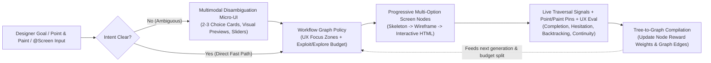

# Forkcast Studio

**Post-Chat UI Generator & UX Evaluator Studio — Multimodal Disambiguation, Point & Paint Steering, and Self-Evolving Workflow Graphs on a Figma-Like Canvas.**

Forkcast Studio lets designers go from an open-ended product idea to an interactive **user flow graph**, disambiguate intent without prose walls, explore **multi-option screens**, steer AI with **Point & Paint manipulation** and **`@Screen` references**, empirically **test flows through live traversal**, and channel **GenAI token spend into the core UX flows that matter most**.

For the hackathon thesis, see [ONE_PAGER.pdf](./ONE_PAGER.pdf). For the full consolidated product & technical specification, see [SPEC.md](./SPEC.md) (and [ARCHITECTURE.md](./ARCHITECTURE.md) for subsystem deep dives).

---

## The Problem

1. **Too Much Text for Visual & Spatial Intent**
   Describing localized UI tweaks in chat prose is high-friction when a designer could simply point at an element, paint over a section, rewire a screen transition, or mention `@Checkout` and say *"make just this piece calmer."*
2. **Premature Guessing, Text Walls & Blind Token Burn**
   AI tools rarely pause to clarify ambiguous intent before acting. Instead of presenting 2–3 quick visual choices, they guess once, emit walls of text, and burn tokens generating full-fidelity mockups for screens the designer hasn't prioritized yet.
3. **No "Unit Test" for Generative UI**
   Unlike application code, synthesized interfaces have no static test for how a human will actually respond until someone traverses them — and flat generators spend the same effort on a *Forgot Password* screen as on a mission-critical *Checkout* or *Onboarding* journey.

---

## The Solution: How Forkcast Studio Works

### 1. Disambiguate Before Generating & Progressive Reveal (Minimum Useful Output)
- **Intent & Ambiguity Engine**: Before spending tokens on full screen generation, Forkcast scores goal uncertainty. When intent is open-ended, it pauses and emits **minimum-effort multimodal disambiguation micro-UIs** — 2–3 visual choice cards, layout/tone previews, density sliders, or scope chips — instead of a 500-word chat dump. When intent is clear, it takes the **Direct Fast Path**.
- **Progressive Reveal**: Never overwhelm the canvas or waste budget upfront. Forkcast outputs a lightweight **User Journey Skeleton** first (connected state cards), then progressively expands into full interactive HTML/Tailwind multi-option screens as you zoom in or mark **Core UX Focus** zones.

### 2. Figma-Style Spatial Canvas (Generative UI Trees → Self-Evolving Workflow Graphs)
- **Freestyle Pan & Zoom Canvas**: Arrange screens freely like Figma artboards, or toggle one-click auto-layouts between **Free**, **User Journey Flow (`L→R`)**, **IA Tree (`T→B`)**, and **Compiled Workflow Graph**.
- **Per-Screen Alternatives, Finalized State & Cognitive Load Controls**:
  - Clicking any screen/micro-UI surfaces its **Proposed Alternatives** alongside a clearly badged **Finalized Version** (1-click *"Set as Finalized"*).
  - Every screen option has a **Show / Hide** toggle so designers can tuck away noisy or parked alternatives and focus only on active candidates, reducing cognitive load.
  - Clicking any screen immediately **highlights the node borders and connecting edges of the Final Flow** (softly dimming exploratory branches) so the committed journey always remains unmistakable on the canvas.
- **Semantic Zoom**:
  - **Macro (Zoomed out)**: Inspect the entire workflow graph, branch probabilities, empirical traversal health, and token budget heat rings around core UX flows.
  - **Mid**: Compare visible multi-option variant stacks (`Option A / B / C`) side-by-side with Thompson sampling confidence and UX eval scores.
  - **Micro (Zoomed in)**: Interact with a live rendered screen, hover DOM elements, drop pins, or brush-paint regions directly.

### 3. Point & Paint Manipulation, Annotation Revisions & `@Screen` Wiring
- **Point Mode (`C`)**: Hover inside any live screen or option to lock onto exact DOM elements (`<button>`, card, navbar, form field) and drop a structured feedback pin.
- **Paint Mode (`B`)**: Brush or lasso directly over any region of a screen (*"collapse this shipping block into an accordion"*), capturing both a visual mask overlay for Gemini's multimodal input and the intersecting DOM nodes.
- **Versioned Annotation Revisions & Selective AI Inclusion**: Annotate any screen and any option; every edit or resolution is saved as an immutable **Annotation Revision** history. Each annotation includes an **`Include in AI`** toggle so designers can keep personal notes or deferred critiques on the canvas without sending them to the AI agent.
- **Connect, Disconnect & `@Reference`**: Drag transition edges between screen ports to restructure the journey, label handoffs (`On Submit`, `Back`, `Empty State`), and reference `@ScreenName`, `@Pin`, or `@Mask` directly in short prompts so Gemini inherits the exact visual style, active variant, and flow neighbors.

### 4. Traversal as Live "Unit Test" + Automated UX Evaluation
- **Play / Traversal Mode (`P`)**: Walk through the connected screens interactively (or run simulated user personas). Both **explicit pin feedback** and **implicit behavioral signals** — smooth click-through completion vs. dwell-time hesitation, dead clicks, and backtracking edges — act as the generative UI's empirical test suite.
- **Multimodal UX Evaluator**: Run AI critique on a single screen, a sub-flow, or the full graph. Evaluates visual hierarchy, clarity, accessibility, and **cross-screen edge continuity** (e.g., verifying `@Checkout` preserves selections and pricing from `@Cart`), dropping actionable AI critique pins right onto offending elements.

### 5. UX Focus Zones & Exploit + Explore Token Spend Budgeting
Forkcast merges **Designer UX Priority** with **Contextual Bandit (Thompson Sampling) Policy** so your GenAI token budget flows to the highest-leverage UX work:

| Priority & Bandit State | Typical Screens | Token Budget Share | Model, Thinking & Variant Policy |
|---|---|---|---|
| **Core Focus — Explore** (High UX impact, uncertain or high-friction) | Onboarding, Core Workspace, Checkout | **~60–65%** | High-reasoning Gemini (`Gemini Pro` + deeper thinking budget), **3–4 divergent variants** sampled via Thompson sampling, interactive fidelity, deep multimodal UX + flow evaluation |
| **Standard — Balanced** | Search, Catalog, Profile | **~25%** | Balanced Gemini (`Gemini Flash`), **2 design variants**, standard heuristic + continuity check |
| **Supporting / Exploit-Locked** (Low UX risk or empirically proven winners) | Settings, Legal, Password Reset, or Locked Winning States | **~10–15%** | Fast lightweight Gemini (`Gemini Flash-Lite`), **1 clean layout or locked winner**, progressive skeleton/wireframe unless promoted, lightweight structural check |

Real `usageMetadata` (`promptTokenCount`, `candidatesTokenCount`, `thoughtsTokenCount`) is tracked per screen and per Focus Zone against your session token cap.

---

## Interaction & Learning Loop

---

## Hackathon Demo Arc

1. **Act 1 — Zero Wall-of-Text Disambiguation & Progressive Flow**
   Give an open-ended prompt (*"Design a specialty coffee subscription checkout"*). Instead of a 500-word dump or blind token burn, Forkcast emits crisp multimodal choice cards and a density slider, then generates a lightweight **Journey Skeleton** and expands only the **Core UX Focus** steps into 3 rich options.
2. **Act 2 — Point, Paint & Rewire Refinement**
   Brush-paint over a cluttered pricing block on `@Checkout` (*"make just this section a sticky summary bar"*), drop a Point pin on the primary CTA, drag a new recovery edge from `@PaymentError`, and run a short `@Checkout match @ProductDetail` prompt — watching surgical multimodal execution without verbose prose.
3. **Act 3 — Live Traversal "Unit Test" & Tree → Graph Evolution**
   Traverse the prototype in Play Mode and run a UX eval pass. Hesitation and backtracking on one variant lower its reward weight while a cleaner variant wins; the **Compiled Workflow Graph** locks in proven `Exploit` nodes and automatically shifts remaining token budget toward `Explore` variants on the remaining bottleneck branch.

---

## Pure Client-Side Tech Stack

- **App**: Vite + React 19 + TypeScript (zero backend required)
- **Canvas & Layout**: `@xyflow/react` (React Flow) + `dagre` (`Free`, `Flow`, `Tree`, and `Compiled Graph` views)
- **Styling**: Tailwind CSS v4 + `lucide-react` (dark Figma-inspired spatial studio)
- **State**: Zustand with local persistence (graph, variants, pins/masks, traces, token ledger)
- **Screen Sandbox & Paint Bridge**: Sandboxed `<iframe>` (`srcdoc`) with Tailwind + `postMessage` DOM element picker + layered `<canvas>` brush mask composer
- **GenAI**: Client-side `@google/genai` SDK (bring your own Gemini API key in Studio Settings; stored locally in the browser)
